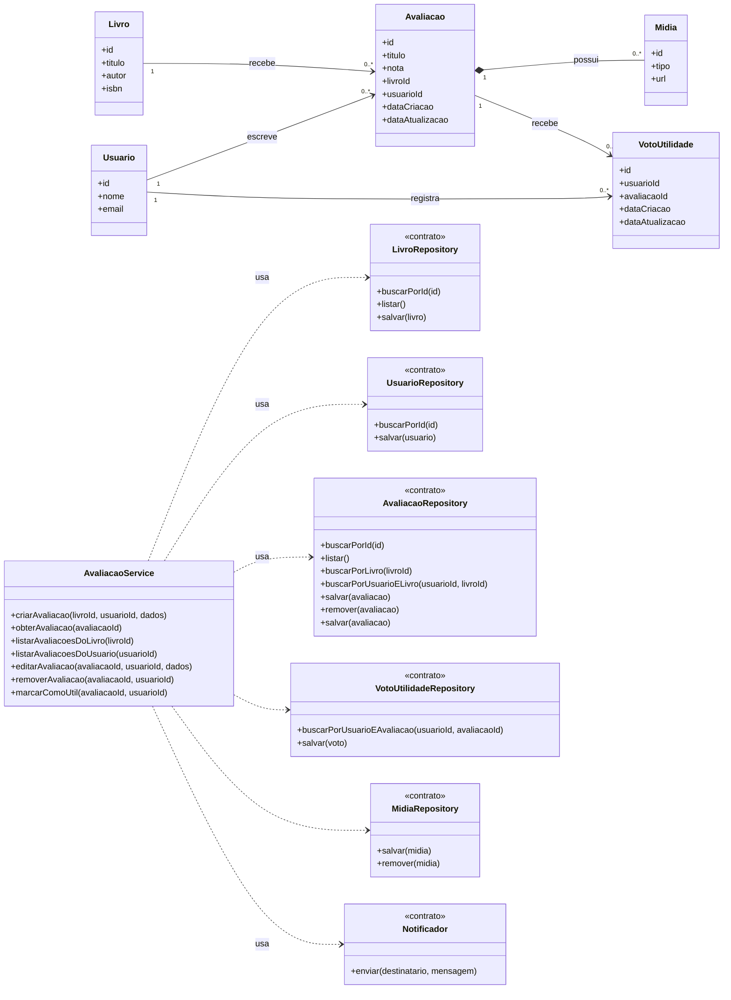

# Modelagem — Projeto 1

**Aluno(a):** Gabriel Caio da Silva Vieira
**Domínio:** Sistema de Avaliação e Recomendação de Livros

## 1. O domínio

O sistema permite que usuários registrem avaliações sobre livros, compartilhem suas opiniões e consultem as experiências de outros leitores.

Cada avaliação pertence a um único usuário e está associada a um único livro. Uma avaliação pode conter um título, uma nota, um texto e mídias complementares, como imagens e vídeos.

Além disso, outros usuários podem indicar se determinada avaliação foi útil. Essa funcionalidade permite identificar opiniões relevantes para a comunidade de leitores.

## 2. Entidades

| Entidade | Atributos | Relacionamentos |
|---|---|---|
| Livro | id, titulo, autor, isbn | Um Livro pode possuir zero ou várias Avaliacao; Um Usuario pode registrar vários votos de utilidade, desde que não vote mais de uma vez na mesma avaliação |
| Usuario | id, nome, email | Um Usuario pode criar zero ou várias Avaliacao |
| Avaliacao | id, titulo, nota, livroId, usuarioId, dataCriacao, dataAtualizacao | Uma Avaliacao pertence a exatamente um Livro e um Usuario; Uma Avaliacao pode possuir zero ou várias Midia; Uma Avaliacao pode receber zero ou vários VotoUtilidade |
| VotoUtilidade | id, usuarioId, avaliacaoId, dataCriacao, dataAtualizacao | Um VotoUtilidade pode ter uma Avaliacao  |
| Midia | id, tipo, url, avaliacaoId | Uma Midia pode ter Uma Avaliacao
## 3. Diagrama de classes

## 4. Responsabilidades

| Classe | Papel | Único motivo para mudar |
|---|---|---|
| Livro, Usuario, Avaliacao | entidades | as regras do próprio objeto (ex.: quando um avaliação é criada) |
| AvaliacaoService | regra de negócio | o processo de avaliar |
| LivroRepository, UsuarioRepository, AvaliacaoRepository | acesso aos dados | a forma de guardar (memória na S3, SQLite na S5) |
| Notificador | comunicação | o canal de aviso (e-mail, SMS) |

## 5. Onde apliquei SRP e DIP

- **SRP:** nenhuma entidade salva a si mesma nem envia e-mail. Guardar é papel dos
  repositories; avisar é papel do Notificador; o processo fica no EmprestimoService.
- **DIP:** o EmprestimoService depende dos contratos dos repositories e do Notificador,
  recebidos pelo construtor. Ele não sabe se os dados estão em memória ou em um banco.

## 6. Fora do escopo (YAGNI)

Login, multas, reservas e relatórios não entram no Projeto 1.
